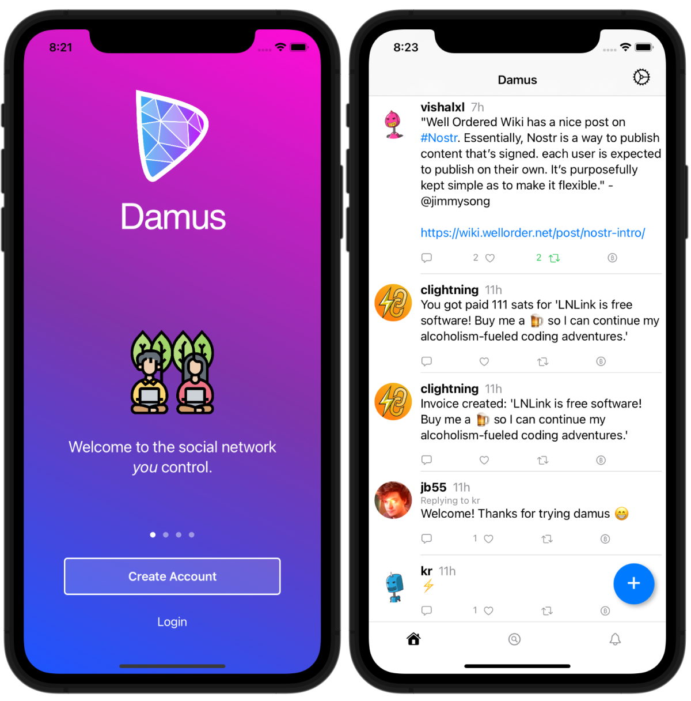

# damus

A twitter-like [nostr][nostr] client for iPhone, iPad and MacOS.

[nostr]: https://github.com/fiatjaf/nostr

## Building from source

Open `gnostr.xcodeproj` and build the `gnostr` scheme, or run `./build.sh`
to build for My Mac. The `Configure damus-c` build phase runs
`damus-c/configurator` before compilation to generate `damus-c-config.h`
in the target's DerivedSources directory. `damus-c/config.h` includes that
generated header.

The configurator compiles feature probes with the selected compiler, SDK,
deployment target, and architectures. It never executes target binaries,
so it also works when cross-compiling. Unsupported optional features use
the bundled CCAN fallbacks; compiler/setup failures stop the build.

For standalone C builds, run `CC=clang sh damus-c/configurator
build/damus-c/damus-c-config.h` and add `-Ibuild/damus-c` to compilation.
Additional compiler flags can follow the output path. Xcode supplies
`CC`, `SDKROOT`, `ARCHS`, and deployment settings automatically. Unaligned
SHA-256 loads remain disabled for correctness.

## Spec Compliance

damus implements the following [Nostr Implementation Possibilities][nips]

- [NIP-01: Basic protocol flow][nip01]
- [NIP-08: Mentions][nip08]
- [NIP-10: Reply conventions][nip10]
- [NIP-12: Generic tag queries (hashtags)][nip12]

[nips]: https://github.com/nostr-protocol/nips
[nip01]: https://github.com/nostr-protocol/nips/blob/master/01.md
[nip08]: https://github.com/nostr-protocol/nips/blob/master/08.md
[nip10]: https://github.com/nostr-protocol/nips/blob/master/10.md
[nip12]: https://github.com/nostr-protocol/nips/blob/master/12.md

## Getting Started on Damus

### Damus iOS

1. Get the Damus app on Testflight: https://testflight.apple.com/join/CLwjLxWl

#### ⚙️ Settings (gear icon, top right)

- Relays: You can add more relays to send your notes to by tapping the "+".
  - Recommended Relays includes WebSocket relay URLs discovered in received
    `r` tags, including NIP-65 kind-10002 relay lists from you and your follows.
    Read/write markers are preserved when adding a suggestion. Duplicate and
    already configured relays are hidden. Discovered suggestions last for the
    current session.
    Adding a relay hides its suggestion; removing a configured relay returns
    it to recommendations. Toggle Ignore to hide a suggestion across launches,
    and enable Show ignored to turn Ignore off again. Ignored relays remain
    hidden when removed or rediscovered.
  - Configured and recommended relays fetch NIP-11 metadata over HTTPS/HTTP
    with `Accept: application/nostr+json`. The NIP-34 label reports whether
    `supported_nips` advertises `34`; this is not a guarantee that every Git
    event kind is accepted. Failed metadata requests show support as unknown.
  - Auto-subscribe to NIP-34 relays is enabled by default. At connection time
    and as relay tags arrive, relays advertising NIP-34 are added to the local
    pool, connected, and receive the app's normal subscriptions without opening
    Settings. This does not publish changes to your relay list. Remove leaves
    a relay suggested but prevents automatic re-addition across launches;
    Ignore also hides it and disconnects it. Add or turning Ignore off explicitly
    allows the relay again. Disabling auto-subscribe stops new automatic additions,
    without disconnecting existing relays.
  - Passive `#gnostr` discovery runs asynchronously on every connected relay,
    including automatically added relays. Relays advertising NIP-50 also get
    a separate `search: "gnostr"` filter (OR, not AND, with the hashtag filter).
    Searches stay subscribed for live events after the initial bounded history,
    resume after reconnect, and merge matching posts/Git events into Home
    without changing your current screen. Relays without NIP-50 still get
    hashtag discovery; unrestricted full-text search is not assumed.
  - The app-wide header places Search to the left of the NIP-34 only toggle
    and the Settings gear immediately to its right, with per-kind controls
    available across tabs and navigation destinations, including profiles,
    threads, search results, and Settings. Focusing Search opens Global Search;
    the query stays in the shared header while navigating. The toggle filters Global Search and
    search-result timelines. Switching it resubscribes with Git-only kinds and
    clears stale results; switching it off restores ordinary posts alongside
    Git events. Explicit repository-kind searches keep their original scope.
    With NIP-34 only enabled, circular on/off buttons let you independently
    select each event kind by number and name. Selections are shared across
    search screens and saved across launches. Turning every kind off stops
    the search subscription rather than sending an unrestricted filter.
    Hashtag search uses the relay's indexed `#t` filter, not a full-text scan.
    Incoming search results are deduplicated and processed in batches of up to
    64, with filtering and sorting on a background task and timeline updates
    spaced at least 30 ms apart. Results appear before the relay finishes its
    history; changing filters or leaving search cancels pending updates.
  - Find more relays to add: https://nostr.info/relays/
- Public Key (pubkey): Your public, personal address and how people can find and tag you
- Secret Key: Your _private_ key unique to you. Never share your private key publically and share with other clients at your own risk!
  - Save your keys somewhere safe
- Log out

#### 🏠 Personal Feed (home icon, bottom navigation)

- Feed from everyone you follow
- Can post notes by tapping the blue + button

#### Notes (under 🏠 Personal Feed)

- Long NIP-34 patches (kind 1617) show the first four commit-header lines,
  with the remaining content collapsed under Show patch. Expand/collapse
  preserves the full plain-text diff, whitespace, and complete commit hashes.
  Short patches remain fully visible.
- Git References is collapsed by default; tap its disclosure chevron to
  expand the branch/tag references and select a complete commit hash.
- Event tag chips fold only when they wrap beyond two rows. The first two
  rows stay visible; Show all tags / Show fewer tags expands or folds the rest
  without shortening tag values or commit hashes. The control stays above the
  chips so it does not move down when the list expands.
- Sending a Note is easy and it goes to both your 🏠 Personal and 🔍 Global Feeds
- To tag a user you must grab their pubkey:
  1. Search their username in the search bar at the top of the 🔍 Global Feed and click their profile
  2. Tap the 🔑 icon which will copy their pubkey to your clipboard
  3. Go back to your 🏠 Personal Feed and tap the blue + button to compose your Note
  4. Add @ direcly followed by the pubkey (e.g., `@npub1xtscya34g58tk0z605fvr788k263gsu6cy9x0mhnm87echrgufzsevkk5s`)
- You can also long-press a Note to grab their User ID aka pubkey or Note ID to link directly to a Note.
- Currently you can't delete your Notes in the iOS app
- Share images by pasting the image url which you can grab from imgbb, imgur, etc. (i.e., `(https://i.ibb.co/2SHZbwm/alpha60.jpg)`). Currently images only load for people you follow in the 🏠 Personal Feed. Images are not automatically loaded in 🔍 Global Feed
- Engaging with Notes
  - 💬 Replying to a Note: Tap the chat icon underneath the note. This will show up in the users’ notifications and in your 🏠 Personal and 🔍 Global Feeds
  - ♺ Reposts: Tap the repost icon which will show up in your 🏠 Personal and 🔍 Global Feeds
  - ♡ Likes: Tap the heart icon. Users will not get a notification, and cannot see who liked their note (currently, web clients can see your pfp only)
- Formatting Notes (may not format as intended in other web clients)
  - Italics: 1 asterisk `*italic*`
  - Bold: 2 asterisk `**bold**`
  - Strikethrough: 2 tildes `~~strikethrough~~`
  - Code: 1 back-tick `code`

#### 💬 Encrypted DMs (chat app, bottom navigation)

- Tap the chat icon and you'll notice there's nothing to see at first. Go to a user profile and tap the 💬 chat icon next to the follow button to begin a DM

#### 🔍 Global Feed (magnify glass, bottom navigation)

- View the Global Feed from all the relays you've added in ⚙️ Settings. Currently you can only search hashtags and user names and pubkeys

#### 🔔 Notifications

- All your notifications except 💬 DMs

#### 👤 Change Your Profile (PFP) and Bio

1. Go to your Profile Page on Damus app
2. Tap on Edit button at the top
3. You will see text fields to update your information and bio
4. For PFP, insert a URL containing your image (support video: https://cdn.jb55.com/vid/pfp-editor.mp4)
5. Save

#### ⚡️ Request Sats

    (Sats or Satoshis are the smallest denomination of bitcoin)

**Alby (browser extension)**

- Get the [Alby](https://getalby.com/) browser extension and create your Alby address [yourname]@getalby.com or connect your existing Lightning wallet
- Convert your Damus secret key from nsec to hex at https://damus.io/key then go to Settings in Alby and under the Nostr section at the bottom of the page add your private hex key. You can also generate new address in the extension
- Click the Alby extension > click Receive > enter the amount of Sats > click Get Invoice > click Copy > then paste into Damus
- Note: On Damus Web it will appear as a string of characters but on Damus iOS it will appear as a clickable image

**Zeus (mobile app)**

- Download [Zeus](https://zeusln.app/) app (iOS, Google, APK)
- Tap Get Started button > tap Connect a node > click on + sign (top right) > select Indhub > press Scan Lndhub QR > (from the Alby browser extension… click your account on the top left > click Manage Accounts > click 3-dot menu to right of your account and click Export Account to get a QR code then go back to Zeus app) > scan the QR Code and tap Save Node Config button
- To create an invoice tap Lightning > tap Receive > type in amount > tap Create Invoice > tap Copy Invoice > paste into a new Damus note

## Contributing

Contributors welcome! [Email patches][git-send-email] to jb55@jb55.com are preferred, but I accept PRs on github as well.

[git-send-email]: http://git-send-email.io

## git log bot

npub1fjtdwclt9lspjy8huu3qklr7eklp5uq90u6yh8mec290pqxraccqlufnas

### Awards

There may be nostr badges awarded for contributors in the future... :)

First contributors:

1. @randymcmillan
2. @jcarucci27
